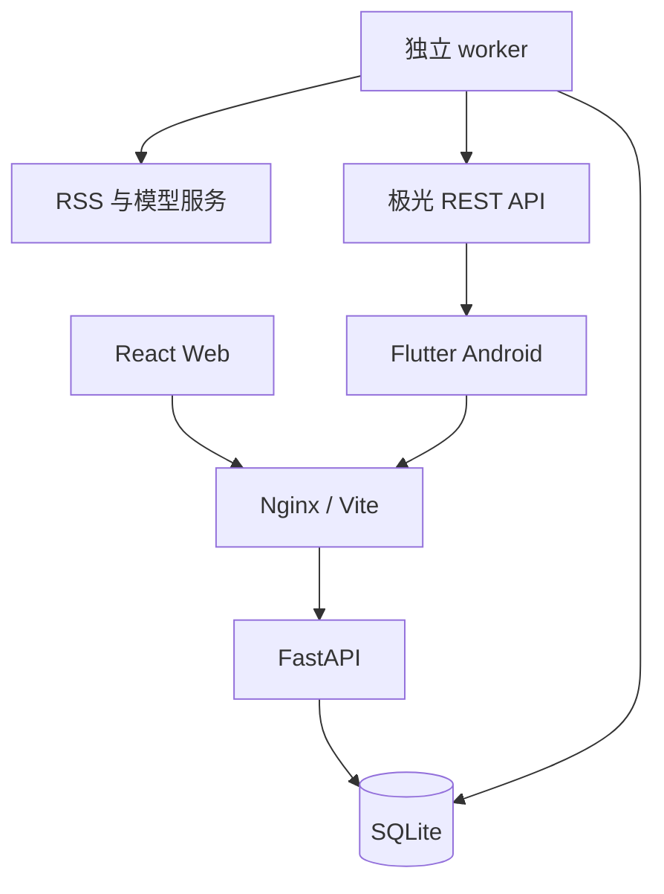

# AI Daily News Assistant

**智能每日新闻总结助手 · v0.4.0 · 四大领域 · 每栏最多 10 条**

React + TypeScript Web、FastAPI、SQLite、独立定时 worker 与 Flutter Android 客户端。关注中国/国际的政治、金融、科技与 AI 人工智能新闻，保留原始来源、发布时间与可区分的 AI 分析。

**GitHub 仓库：[Kaneis-git/-](https://github.com/Kaneis-git/-)。** 本项目的所有模块直接放在仓库根目录。可点击仓库页面的 **Code → Download ZIP** 下载，全部解压后再运行；也可以使用下文的 Git 克隆命令。

## Web 版与 App 版在哪里

| 部分 | 源码与中文说明 | 用途 |
|---|---|---|
| Web 网页版 | [frontend](frontend/README.md) | 电脑浏览器使用，默认入口为 `http://localhost:3000` |
| Android App 版 | [mobile](mobile/README.md) | Flutter 源码，需构建 APK 后安装到手机；本仓库不附预编译 APK |
| 两端共用后端 | [backend](backend/README.md) | FastAPI 接口、新闻采集、账号、收藏和定时任务 |
| AI 分析模块 | [ai-service](ai-service/README.md) | 分类、摘要、影响分析与模型输出校验 |
| 数据库 | [database](database/README.md) | SQLite 表结构说明，用户数据在运行时创建 |

首次阅读可从 [代码导读与功能定位](docs/CODE_GUIDE.md) 开始。Windows 用户按 [Python + Node.js 启动说明](docs/WINDOWS_LOCAL_START.md) 操作。Web 和 App 使用同一个后端地址与账号，收藏可以跨端同步。

如果项目位于已有 GitHub 仓库的 `AI-News/` 子目录，后续命令均从该子目录执行；下载整个仓库后，应打开含 `manage.py` 和 `start-windows.cmd` 的这一层文件夹。

## 本次新增

中国、国际各四栏，每栏由最多 3 条提升为最多 10 条，每期最多 80 条。新增独立 AI 分类，并同步 Web、搜索、详情、日报导出与 Android 源码。历史与收藏快照保留。

**现有 D 盘安装用户：**使用此前单独交付的 `AI_News_AI_Upgrade.zip` 时，停止服务后解压并双击 `01-update-news.cmd`；无需重新安装运行环境。该增量包不包含在 GitHub 源码中。从 GitHub 更新请按 [升级说明的“源码 / Docker 用户”部分](docs/AI_CATEGORY_UPGRADE.md) 合并配置。

以下 Phase 2 / Phase 3 功能继续保留：

| 阶段 | 功能 |
|---|---|
| Phase 2 | 注册、登录、退出当前/全部设备、Web 修改密码；跨端收藏、私人标签、中文搜索、区域/领域/日期筛选、分页 |
| Phase 3 | Flutter Android 日报、详情、历史、搜索、收藏/标签、设置；安全凭据、7 期公共日报离线缓存；极光通知订阅、权限处理、点击跳转 |
| 数据升级 | SQLite 自动备份与 Alembic 迁移；保留 Phase 1 日报和主键；收藏保存独立快照 |
| 工程 | 依赖锁文件、模块化代码、测试、Windows Compose、GitHub Actions 测试与 debug APK 构建配置 |

**交付完整源码，不附 APK。** 当前 Web/后端与升级包验证见 [v0.4.0 测试报告](docs/AI_CATEGORY_TEST_REPORT.md)。Android 源码已更新；本轮环境无法获取 Flutter SDK，未重新执行 Flutter 测试或构建 APK。此前版本的验证记录见 [Phase 2 / Phase 3 测试报告](docs/TEST_REPORT.md)。远端自动检查以仓库 Actions 的实际结果为准，提供配置不代表已通过构建。

没有填写模型配置时，系统显示来源摘要与规则排序，不把它标成 AI 影响分析或自动翻译。

## Windows 本地启动

安装 Docker Desktop，启用 WSL2 与 Linux 容器。解压后在 AI-News 目录打开 PowerShell：

```powershell
Copy-Item .env.example .env  # 仅首次安装，升级保留旧配置
docker compose up --build -d
docker compose ps
```

- Web：<http://localhost:3000>
- API：<http://localhost:8000/api/v1/health>
- API 文档：<http://localhost:8000/docs>

旧版独立 Compose 可用 `docker-compose up --build -d`。首次下载依赖需要网络；本环境没有 Docker CLI，不声称已在 Windows 实机部署。

进入“我的账号”注册后可手动更新早报。自动任务不需要登录。API 与 worker 应同时运行；北京时间 08:00 **开始生成**，完成后发布和通知，不能保证固定在 08:00 到达。

```powershell
docker compose logs --tail=100 api worker
docker compose down  # 保留数据；不要添加 -v
```

数据库在 `news_data` 持久卷。停止电脑、Docker 或 worker 时无法执行定时任务。

## 从 Phase 1 升级

1. 停止旧 API/worker，并备份数据目录或 Docker 卷。
2. 更新源码，保留原 `.env`、`backend/sources.json` 与数据卷。
3. 执行 `docker compose up --build -d`。首次启动应用 `001_mvp → 002_users → 003_push`，实际升级前用 SQLite backup API 生成 `news.db.before_时间戳.bak`。
4. 核对历史日报后注册新账号；没有默认管理员或默认密码。
5. 迁移失败终止启动。恢复时停止所有进程，使用升级前完整备份与匹配旧代码，不执行删表式 downgrade。

迁移使用文件锁和事务，保留新闻/日报主键。收藏保存当时的 snapshot，日报重跑不会覆盖旧收藏。自行修改旧表结构时需检查迁移，不能把 create_all 当作自动升级。

## 账号、收藏、搜索

用户名 3–32 位英文字母、数字、下划线，不区分大小写；昵称可用中文；密码 10–128 位、Argon2id 哈希。会话默认 30 天，可撤销，每账号最多 10 个未撤销会话；没有邮件验证与密码找回服务。

Web 使用 HttpOnly、SameSite=Strict Cookie；App 使用 Bearer token 与系统安全存储，数据库仅存令牌哈希。修改密码/退出全部设备会撤销会话、停用设备并取消待发通知；已发送或服务商已受理的通知不能保证撤回。

最多 5000 条收藏、100 个私有标签，每条收藏最多 20 个标签。标签可新增、重命名、删除，删除标签保留新闻。App 长按标签即可编辑。

搜索范围为已发布日报的标题、来源摘要和分析摘要，支持中文子串、区域、类别、日报日期与分页。同一新闻跨日报去重，不声称检索未采集全文。公共日报可匿名阅读，手动生成须登录；设置 `ADMIN_TOKEN` 后还需管理口令，以控制调用费用。

## Android 运行与构建

详见 [Android 指南](mobile/README.md)。Android 7.0 / API 24 起；iOS 工程和 APNs 留待后续。

准备 Flutter **3.47.7**、JDK 17、Android Studio / SDK Platform 36、Build-Tools、Platform-Tools、Command-line Tools、NDK 28.2.13676358；自行阅读并确认 SDK 许可。

```powershell
cd mobile
flutter doctor -v
flutter pub get --enforce-lockfile
flutter analyze
flutter test
flutter build apk --debug
```

构建成功后输出 `mobile/build/app/outputs/flutter-apk/app-debug.apk`。debug 包未填推送 AppKey 也可阅读和登录；模拟器默认访问 `http://10.0.2.2:3000/api/v1`。App 设置页可改地址。

真机不能用自己的 localhost 访问电脑。假设电脑 IP 为 192.168.1.20，在根 `.env` 配置：

```dotenv
WEB_BIND_ADDRESS=0.0.0.0
ALLOWED_HOSTS=localhost,127.0.0.1,api,testserver,192.168.1.20
ALLOWED_ORIGINS=http://localhost:3000,http://127.0.0.1:3000,http://192.168.1.20:3000
```

重新创建服务 `docker compose up -d --force-recreate`；同一局域网手机填 `http://192.168.1.20:3000/api/v1`，Windows 防火墙仅对可信私有网络开放 3000。原生开发时 Vite 使用 `npm run dev -- --host 0.0.0.0`。

release 必须提供真实 HTTPS API 与自己的签名；工程不会默认拿 debug key 签正式包。

## 极光推送

在极光创建包名为 `cn.ainews.ai_daily_news` 的 Android 应用。后端根 `.env` 填：

```dotenv
PUSH_PROVIDER=jpush
JPUSH_APP_KEY=你的AppKey
JPUSH_MASTER_SECRET=你的MasterSecret
```

客户端复制 `mobile/config.example.json` 为 `mobile/config.json`，填写 `API_BASE_URL` 和公开的 `JPUSH_APPKEY`。安装包和后端 AppKey 必须一致。**Master Secret 只能放后端。**

```powershell
flutter build apk --debug --dart-define-from-file=config.json
```

用户登录后主动同意提醒并授予系统通知权限，才初始化推送 SDK 和登记设备。非空日报与通知记录在同一事务发布；worker 每 10 秒发送。同一设备/日期只生成一条记录，重复生成不重复入队。

429 或连接未建立采用 60/120/240 秒退避、最多 4 次总尝试。超时、5xx、回执不确定或发送中进程退出记为 unknown，不盲目重发。accepted 仅表示服务商受理，不证明手机展示。App 可查看最近 50 条记录；消息 24 小时后过期。

本版为极光基础 Android 通道，没有配置华为、小米、OPPO、vivo 等厂商离线通道。强制停止、系统省电或无网络时不承诺送达。每账号最多 20 条设备记录，长期重装积累需管理员清理。

## 新闻源与 AI 配置

```dotenv
AI_BASE_URL=https://your-provider.example/v1
AI_API_KEY=你的密钥
AI_MODEL=该供应商支持的模型名称
```

AI_BASE_URL 会追加 `/chat/completions`。供应商应接受 messages、model、temperature、max_tokens，返回 choices[0].message.content；实际兼容性、质量和费用需用自己的服务核验。变更后执行 `docker compose up -d --force-recreate api worker`。

日报 D 的时间窗为 `[D-1 08:00, D 08:00)`，按北京时间与原文发布时间筛选。每 30 分钟采集以缓解 RSS 列表更新丢失；首日或关机后无法补齐消失的历史新闻。

`backend/sources.json` 默认启用中新网三个源、BBC 三个源，以及量子位和 TechCrunch AI；IT之家备用停用。中国/国际各四类，每个分区最多 10 条，每日报最多 80 条；默认每格 20 个候选、合计最多 160 个候选参与分析。全部源失败保留旧日报，部分失败显示 partial；不编造新闻填空。Reuters/Bloomberg 授权 API 未接入，网络可达性以用户环境为准。

## 架构与模块



| 目录 | 职责 |
|---|---|
| frontend | 页面、Cookie 会话、账号/搜索/收藏与交互测试 |
| backend/app | API、采集、认证、收藏、事务通知队列 |
| backend/migrations | 冻结的 Alembic 升级版本 |
| backend/tests | 回归、隔离、通知与迁移测试 |
| ai-service | 模型适配、提示词和结构校验 |
| database | 参考 DDL；运行数据不提交 |
| mobile/lib | models、services、state、screens、widgets |
| mobile/android | Gradle、通知权限、网络与签名配置 |
| docs | 当前设计和测试记录；Phase 1 历史文件仅供参考 |

详细表结构与 API 见 [项目设计](docs/PROJECT_DESIGN.md)。

## 原生 Windows 开发与测试

需要 Python 3.12、Node 24.x LTS（至少 24.15）。安装后，在项目根目录双击 **`start-windows.cmd`**：自动安装依赖、保留已有 `.env`、启动 API/worker/Web，并在健康检查通过后打开 `http://localhost:3000`。保持窗口开启，按 Ctrl+C 停止。安装和故障排查见 [Windows 本机启动说明](docs/WINDOWS_LOCAL_START.md)。

以下是不用启动器时的手动方式，在三个 PowerShell 窗口分别运行：

```powershell
if (!(Test-Path .env)) { Copy-Item .env.example .env }
py -3.12 -m venv .venv
.\.venv\Scripts\python.exe -m pip install -r backend\requirements.txt
.\.venv\Scripts\python.exe manage.py api
```

```powershell
.\.venv\Scripts\python.exe manage.py worker
```

```powershell
cd frontend
npm.cmd ci
npm.cmd run dev -- --strictPort
```

检查命令：根目录 `python -m pytest`（使用上述虚拟环境）、frontend 中 `npm test` / `npm run build`、mobile 中 `flutter analyze` / `flutter test`。

## GitHub 和正式部署

### 下载并在 Windows 启动

电脑已安装 Git、Python 3.12 与 Node.js 24.x（至少 24.15）时，在 PowerShell 执行：

```powershell
Set-Location D:\
git clone https://github.com/Kaneis-git/-.git AI-News
Set-Location .\AI-News
.\start-windows.cmd
```

若 `D:\AI-News` 已存在，换一个空目录名；已有运行中的安装请按 [升级说明](docs/AI_CATEGORY_UPGRADE.md) 备份并保留配置和数据。源码不附 Python、Node.js 或 Flutter 安装器，准备环境见 [Windows 启动指南](docs/WINDOWS_LOCAL_START.md) 与 [Android 指南](mobile/README.md)。

### 自动检查与 APK

[CI 配置](.github/workflows/ci.yml) 提供 API/Web/Flutter 检查，并在 Android debug 构建成功后上传 `daily-news-android-debug` artifact。在仓库 **Actions → API Web Android checks → 某次成功的运行 → Artifacts** 中查看；只有 Android 构建成功且产物未过期时才有 APK 下载，不携带生产密钥、不发布商店。失败时需查看对应任务日志。

本仓库直接使用根目录工作流。以后若将项目复制到其他仓库的 `AI-News/` 子目录，需要相应调整工作流位置和路径，详见 [代码导读](docs/CODE_GUIDE.md)。

GitHub Pages 不能承载 Python、SQLite 持久写入与常驻 worker。线上需容器主机、持久磁盘、HTTPS、真实 ALLOWED_HOSTS / ALLOWED_ORIGINS、COOKIE_SECURE=true、备份和监控。默认端口只绑定本机。应用不信任任意 X-Forwarded-For，经 Nginx 的用户共享 IP 限流配额；公网按实际代理拓扑配置入口限流。

## 后续计划

Phase 4 趋势图、新闻问答、推荐和周/月总结尚未开发；iOS 需原生工程、签名与 APNs。SQLite 特定迁移/查询不能只改 URL 就切换 PostgreSQL。当前 worker 为单实例，扩容再引入 Redis/Celery。

Android 离线只读公共缓存；收藏/搜索/账号操作需网络。评分表示阅读优先级，不表示投资收益。真实模型、来源与通知须在目标环境验收。

官方参考：[Flutter Android](https://docs.flutter.dev/deployment/android)、[Flutter SDK 归档](https://docs.flutter.dev/install/archive)、[JPush Flutter](https://pub.dev/packages/jpush_flutter)、[JPush REST API](https://docs.jiguang.cn/jpush/server/push/rest_api_v3_push)。
