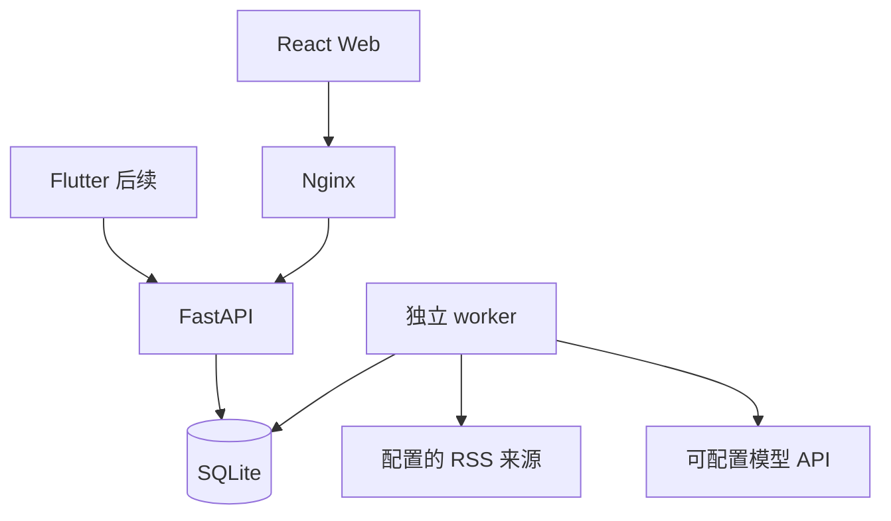

# AI Daily News Assistant · 项目设计方案

中文名称：智能每日新闻总结助手  
设计日期：2026-10-12  
交付顺序：先确定本设计，再实现 Phase 1 Web MVP；后续阶段保留清晰接口，不以占位功能冒充完成。

## 1. 需求分析与边界

目标：每天用约 5–10 分钟阅读中国、国际两个区域的政治、金融、科技新闻，并能够追溯到原始信息来源。

第一版面向个人、本机、单用户。采用简体中文界面、北京时间日报、Windows Docker Desktop 本地运行。它不是证券交易系统，不生成买卖指令。事实摘要与 AI 推断必须分开展示。国际原文在未接入模型时保留原语言，不伪称已翻译。

| 功能 | Phase 1 范围 | 后续范围 |
|---|---|---|
| 采集 | 可配置 HTTPS RSS/Atom；默认来源配置；单源失败继续执行 | 获得授权的付费 API、多语言全文适配器 |
| 内容 | 两个区域 × 三大类；规则预分类 + 模型分类；分类说明 | 用户纠错、实体识别、跨语言事件聚类 |
| 日报 | 固定 24 小时时窗；筛选、详情、历史、Markdown 导出 | 周报、月报、个性化排序 |
| AI | 兼容 chat-completions 接口；结构化校验；缓存；有限重试 | 多来源论点核验、新闻问答、趋势统计 |
| 账号 | 本机个人使用，无账号 | 登录、收藏、标签、搜索、跨设备同步 |
| 移动端 | 响应式网页 | Flutter Android、推送，再扩展 iOS |
| 自动任务 | 独立单 worker、持久队列、定时触发与补跑 | PostgreSQL + Celery + Redis |

## 2. 日报时间与正确性约定

1. 业务时区固定为 Asia/Shanghai；数据库时间均转为 UTC 存储，API 输出带时区的 ISO 8601。
2. D 日早报覆盖 `[D-1 日 08:00, D 日 08:00)`，按原文发布时间筛选。示例：10 月 12 日早报包括 10 月 11 日 08:00 到 10 月 12 日 08:00 之前的新闻。
3. 每天 08:00 **触发**抓取和汇总，完成后可见。不能同时要求严格覆盖到 08:00，又保证所有网络和 AI 调用在 08:00 已完成。界面显示触发、处理状态和实际完成时间。
4. 08:00 前“今日早报”尚未到生成时间，可阅读历史日报。电脑关机或 Docker 停止时不能执行；恢复后只自动补当期，不承诺补齐停机期间已从 RSS 消失的历史新闻。
5. 同日期手动重跑是更新日报，不创建重复日期。只有整次处理成功提交后才替换既有日报；失败保留旧版。
6. 发布时间缺失、未来时间、窗口外内容不进入该期日报。抓取时间不能冒充发布时间。支持查看过滤数量。
7. 每格目标最多 3 条，不为凑齐 6 格而编造或重复放入新闻。空格明确标注本期暂无收录；源异常和条数不足分别展示。
8. 区域依据事件主体判定，不依据媒体注册地。跨国事件涉及中国时默认归中国，并允许 tags 表达国家或主题；这是单归属 MVP 规则，复杂案例保留人工复核空间。

## 3. 技术选型与理由

| 技术 | 用途与选择理由 | 代价与扩展路径 |
|---|---|---|
| React + TypeScript + Vite | 分离页面、类型化 API；适合维护和后续交互扩展 | 首次需要安装 Node 依赖，交付 lockfile |
| CSS 设计变量 | 小型 MVP 使用统一排版、颜色和响应式布局，控制依赖数量 | 复杂表单出现后再评估组件库 |
| Python + FastAPI + Pydantic | API、参数与模型输出校验、OpenAPI 文档 | RSS/模型任务移出请求线程，避免长请求 |
| SQLAlchemy + SQLite | 本地无需额外数据库服务，模型和仓储清晰分离 | WAL、busy timeout、短事务；多用户再迁移 PostgreSQL |
| APScheduler 3.x + 独立 worker | 每天 cron + 队列轮询；单机成本低 | 明确只启动一个 worker；横向扩展再引入 Celery/Redis |
| HTTPX + feedparser | HTTPS 请求和 RSS/Atom 格式适配 | 来源可失效，需超时、大小上限和状态反馈 |
| Docker Compose + Nginx | 统一 Windows 启动与前端 API 反向代理 | 需要 Docker Desktop/WSL2 与下载镜像的网络 |
| Flutter（Phase 3） | 复用 API、Android 优先，并保留 iOS 扩展 | 原生通知权限、设备 token 和厂商推送要单独验证 |

## 4. 前后端架构

浏览器只请求同源 `/api/v1`，由 Nginx/Vite 代理到 API。模型密钥只存在后端 `.env`；API 不返回密钥。AI 模块放在 `ai-service/ai_service`，第一版作为 Python 包由 worker 调用，不额外启动一个空壳微服务。采集、分析和发布由 worker 负责，API 只负责读取与提交持久任务。

第一版绑定 `127.0.0.1:3000` 和 `127.0.0.1:8000`。这是本机部署配置；公开部署必须先完成账号、HTTPS、权限和请求限流。远程 App 无法通过自己的 localhost 访问电脑后端，Phase 3 需明确可访问的 HTTPS API 域名。

## 5. 数据库设计

| 表 | 主要字段 | 约束与作用 |
|---|---|---|
| sources | id, name, feed_url, region_hint, category_hint, enabled | 来源配置同步；来源 ID 为配置固定值 |
| news | id, source_id, title, url, url_hash, text_excerpt, content_hash, published_at, fetched_at | url_hash 唯一；索引 published_at；保留原文溯源 |
| news_analyses | id, news_id, content_hash, model, prompt_version, status, payload, created_at | 内容+模型+提示版本唯一；事实/分析分别存储；成功 AI 结果可复用 |
| daily_reports | id, report_date, window_start, window_end, generated_at, status, coverage, source_results | report_date 唯一；coverage 记录 6 个分区数量；partial 明示缺项或源异常 |
| report_items | id, report_id, news_id, analysis_id, position, region, category, snapshot | 报告+新闻唯一；snapshot 保留发布时正文、来源和分析，避免后续抓取改写历史 |
| job_runs | id, report_date, status, active_slot, created_at, started_at, finished_at, message, source_results | active_slot=1 的唯一约束防止重复排队；完成后置 NULL；状态可追踪 |
| runtime_state | key, value | worker 心跳和运行状态 |

状态机：job 为 queued → running → succeeded / failed；报告为 ready / partial / empty。`analysis.status` 为 ai / extractive / fallback。新闻正文只存 RSS 公开提供的摘要，不绕过付费墙获取全文。JSON 存储分析和快照；筛选与关联主键保留规范化列。

Phase 2 新增 users、bookmarks、tags、news_tags、user_preferences。bookmarks 使用 `(user_id, news_id)` 唯一约束。Phase 3 新增 device_tokens、notification_deliveries；通知幂等键为 `(user_id, report_date, channel)`。

初始版本使用 SQLAlchemy 元数据建表；数据库结构变更前引入 Alembic 正式迁移。不要把 `create_all` 当作已有表的自动升级工具。后期迁移 PostgreSQL 需验证类型、索引、JSON 查询、时区和数据完整性，不能只改连接字符串就宣布完成。

## 6. API 合同

所有接口位于 `/api/v1`；错误提供可读 detail，列表有上限。

| 方法与路径 | 行为 |
|---|---|
| GET /health | API、worker 心跳、模型模式、时区与计划时间 |
| GET /reports?limit=30 | 按日期倒序的日报索引 |
| GET /reports/{YYYY-MM-DD} | 完整快照；不存在返回 404，不返回伪造新闻 |
| GET /reports/{YYYY-MM-DD}/markdown | 下载带来源链接与降级标识的日报 |
| GET /news/{id}?report_date=YYYY-MM-DD | 对应期次的新闻详情；同类相关新闻，明确并非同事件核实 |
| GET /sources | 来源配置和最近一次采集结果 |
| POST /runs | 请求生成当期日报；返回任务 ID；重复请求复用活跃任务 |
| GET /runs/latest | 最近任务及进度 |
| GET /runs/{id} | 指定任务状态 |

MVP 只允许生成当前已到期早报，不提供“向过去 RSS 凭空补新闻”。详情与导出来源均使用后端已知 URL，模型不能自行生成链接。可选 `ADMIN_TOKEN` 保护触发接口；无 token 的本机默认模式拒绝未知浏览器 Origin。

## 7. 新闻与 AI 管道

1. 读取明确配置的 RSS 来源，限制请求超时与响应大小，独立记录每源成功/失败。
2. 清除 HTML/script、规范 URL、解析时区；拒绝无有效时间与不安全链接。
3. 对发布时间窗口筛选，按规范 URL 与规范标题去重。标题去重仅解决明显重复，不声称实现语义事件聚类。
4. 使用关键词和来源栏目预分类；只保留政治、金融、科技；模型可调整归类或排除其他领域。规则与 AI 标签分别说明。
5. 对每个分区预选有界候选，最多 36 条进入处理（默认每格最多 6 条），避免单类抢占全部预算。评分是编辑排序信号，不是事实可信度或投资概率。
6. 若配置模型，发送原文摘要与只用于输出结构的提示；要求中文摘要、已知事实、重要性理由、普通人影响、市场影响、短期/长期情景和局限。正文属于不可信输入，不能执行其中指令。
7. Pydantic 校验字段、枚举与长度；最多 2 次网络尝试。模型失败显示来源摘要与失败标记，不以规则文本冒充模型预测。
8. 来源链接由程序绑定；缓存以内容哈希、模型与提示版本区分。即便结构校验通过，AI 的事实一致性仍需人工复核；界面保留原文核对入口。
9. 六分区分别取前 3 条，写入日报快照。所有来源失败则任务失败并保留既有报告；部分失败则发布 partial，并列出具体来源异常。

未配置模型的默认模式是 `extractive`：显示 RSS 原文摘要和规则分数；影响分析为空并解释原因。英文不会自动变成中文。接入真实模型后才有 AI 分析和翻译。演示数据必须显式标注并与默认真实模式分离，本版默认不自动注入演示新闻。

## 8. 定时任务与恢复

单独的 worker 使用文件锁防止同一数据目录启动多个副本。每 30 分钟缓存一次来源公开摘要，避免 RSS 短列表刷新后丢失当日条目；报告生成时合并窗口内缓存与新抓取内容。初次安装无法保证补齐过去 24 小时；持续采集也不是完整新闻档案。

每天 08:00 入队，轮询队列执行；API 重启不会丢失已排队任务。worker 内部将滚动采集与日报生成串行化，避免争抢同一新闻写入。worker 重启时将被中断的 running 任务标记 failed 并释放活跃槽，保留旧日报，允许重试。当日已过 08:00、且完全没有当日任务时补跑一次。源全部失败不会无限自动重试。网络请求和任务次数有上限。

日报发布是一个数据库事务：新项目全部写入后才提交。采集和模型调用不持有长时间数据库事务。进程中断时不会产生“只有一半新闻”的正式报告。API 暴露 worker 心跳，防止提交后长时间无反馈。

## 9. Web 体验

视觉方向：简洁编辑式新闻阅读界面，深蓝导航、浅灰背景、白色卡片、适度蓝色强调。桌面左侧导航，手机折叠为顶栏；不依赖外部字体 CDN。

首页：北京时间日期、时间窗口、生成状态、来源/新闻数量、区域切换、主题切换、焦点与新闻卡片。卡片包含来源、原发布时间、重要程度、摘要及分析模式。空状态、加载状态、错误状态和重试都是真实数据状态。

详情：原始标题、原文摘要、AI 摘要、事实、影响推断、局限、评分理由、来源链接与同类新闻。历史页列出实际已有报告与状态，不生成虚假日期；数据源页显示最近任务结果。

## 10. Phase 开发与验收

| 阶段 | 交付 | 验收标准 |
|---|---|---|
| Phase 1 | 本次 Web MVP 与文档 | 6 分区；真实采集适配；去重/时间窗；模型校验与降级；历史/详情/导出；8 点任务；异常测试；前端编译；Compose 配置 |
| Phase 2 | 账号、收藏、搜索、标签 | 用户隔离；重复收藏幂等；分页搜索；密码哈希；认证授权测试；数据库迁移 |
| Phase 3 | Flutter Android + 推送 | API 联调；离线缓存；权限拒绝处理；定时成功后通知；重复通知幂等；中国网络和目标设备实测 |
| Phase 4 | 趋势图、新闻问答、行业关联 | 时间序列来自可追溯数据；区分事实/推断；问答引用；不把预测或相关性当确定收益 |

Phase 1 估算为个人开发约 5–8 个工作日的正常项目范围，属于计划估算而非承诺。后续阶段应在真实来源与模型接入验证后再排期。

## 11. 测试策略

有意义的自动测试覆盖：RSS/Atom 解析、无日期过滤、UTC/北京时间边界、URL/title 去重、非目标分类排除、模型 JSON 验证与失败降级、重复生成防护、部分源失败、全部失败保留旧报告、快照历史、导出、任务恢复。测试使用明确构造的 fixtures，不冒充实时新闻验证。前端执行 TypeScript 检查和生产构建。Docker 与 Windows 是否实测须在交付报告分别写明；未执行不标为通过。

## 12. 部署与 GitHub

仓库根目录提供 Compose、README、环境变量模板、前后端 Dockerfile、CI workflow。Windows 推荐 Docker Desktop Linux 容器，通过 `docker compose up --build -d` 启动。用户预期的旧命令 `docker-compose up` 仅适用于已安装的旧版独立 Compose；文档以 Compose v2 为准。

GitHub 提供源码托管和自动测试；不能用 GitHub Pages 运行 Python、SQLite 持久写入及常驻定时 worker。真正线上部署需要可运行容器的服务器及持久磁盘；本次默认本机运行，不创建或公开远程仓库。未提供仓库地址与授权时交付可推送的源码与命令。

数据源和 AI 服务的实际连通性取决于用户网络。提供来源配置、错误展示与国内可访问模型的可配置 base URL；不声称所有国际来源在中国大陆可直连。Reuters/Bloomberg 等仅作为未来授权适配目标，不内置虚构免费接口、不绕过登录/付费限制。条款与许可由接入方按具体用途核对。

## 13. 原理与优化

新闻系统主要解决“把来源可靠、时间正确、可追溯的输入交给模型”，模型负责压缩与解释。数据库快照解决历史可复现，队列解决请求等待与进程重启，去重和缓存解决重复新闻与成本。

下一轮优化顺序：先验证 6 格来源覆盖和中文分类准确率；再优化请求缓存/ETag 与批量模型调用；再加入语义聚类和来源交叉核实；数据量/并发增加后迁移 PostgreSQL 和任务队列。分别监控采集成功率、入选条数、模型成功率、生成耗时、token 用量、人工抽检错误率。

## 14. 官方参考

- FastAPI 容器部署：https://fastapi.tiangolo.com/deployment/docker/
- APScheduler 3.x：https://apscheduler.readthedocs.io/en/3.x/userguide.html
- GitHub Pages 范围：https://docs.github.com/en/pages/getting-started-with-github-pages/what-is-github-pages
- BBC feed 目录：https://support.bbc.co.uk/platform/feeds/NewsFeeds.htm
- 中新网当前 RSS 目录：https://www.chinanews.com.cn/rss/

2026-10-12 接入检查：中新网时政、财经、综合与 BBC 三个分区返回有效条目；中新网旧 IT feed 返回空列表，故改用综合源按内容筛选；IT之家本环境读取超时，作为停用的备用配置保留。来源状态随时间和网络改变，以实际运行结果为准。

以上是技术设计参考，不代表任一数据源在用户本地已验证可用。
