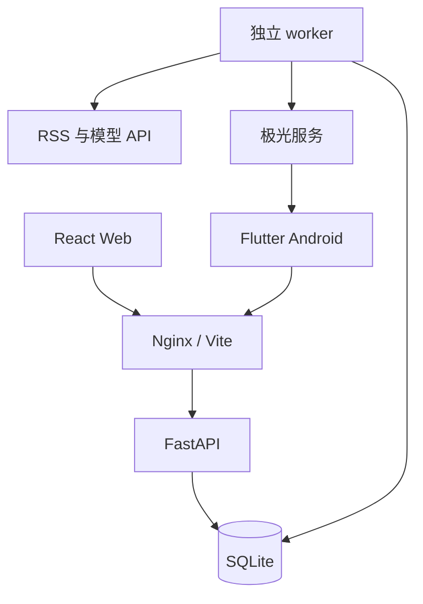
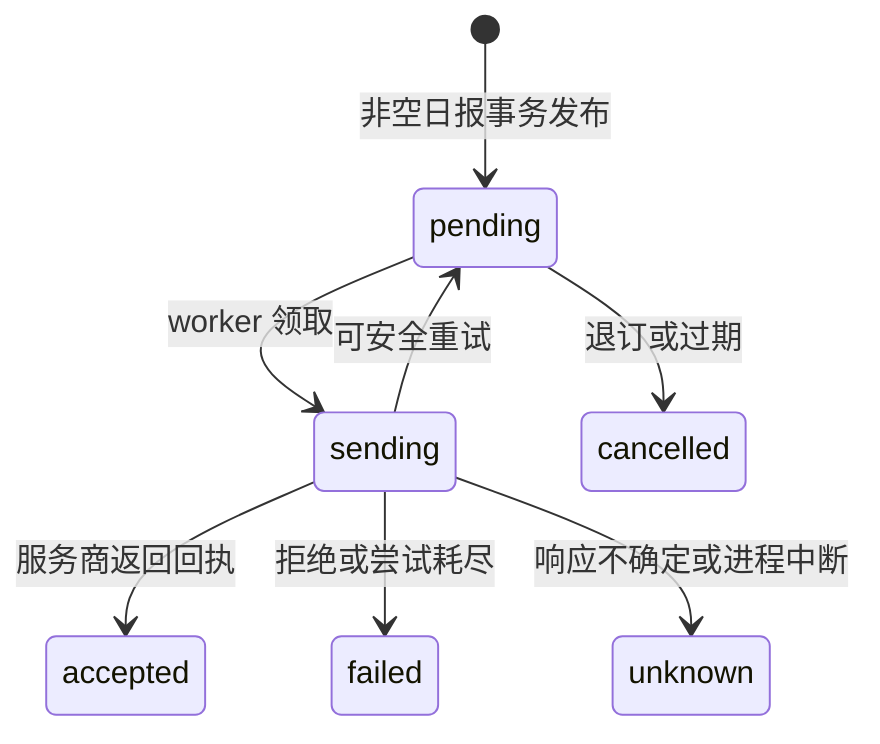

# AI Daily News Assistant · v0.4.0 项目设计

中文名：智能每日新闻总结助手。更新日期：2026-10-13。

## 需求与范围

Phase 1 的新闻采集、八分区日报、摘要/分析、历史、详情、来源和导出继续保留。本轮完成 Phase 2 用户系统、收藏、私人标签与搜索，及 Phase 3 Flutter Android 客户端和极光推送接入源码。

**Phase 2 已实现；Phase 3 源码与 Flutter 自动化检查完成，Android SDK 缺失导致原生编译/APK 未交付，真实推送尚待极光配置与真机验收。** iOS、趋势预测、股票分析图、问答与个性化推荐属于后续范围。原 Phase 1 设计保存在 PHASE_1_DESIGN.md，仅作历史记录，当前行为以本文件与 README 为准。

## 架构

React/TypeScript 管理 Web 页面、Cookie 会话和收藏状态；Flutter 按 models/services/state/screens/widgets 分层。FastAPI 处理读取、鉴权、收藏和设备注册，worker 独立执行采集、分析、发布、通知。ai-service 为共享 Python 模块，不额外部署空微服务。

SQLite 使用 WAL、busy timeout、短事务；worker 用文件锁保证单实例。定时任务用 APScheduler，排队状态持久写入数据库。本版无需 Redis/Celery；迁移 PostgreSQL 时要适配 SQLite 特定的 JSON 查询、冲突处理、锁与迁移，不能只更换 URL。

## 新闻与时间口径

业务日期按 Asia/Shanghai；时间点使用 UTC 存储，API 输出带时区 ISO 8601。D 日早报覆盖 `[D-1 08:00, D 08:00)` 原文发布时间。08:00 开始生成，完成后才发布与通知；不保证固定 08:00 送达。每 30 分钟滚动采集，停机后只补当期，不能补齐已从 RSS 消失的历史条目。

源配置为 HTTPS RSS/Atom；默认中新网与 BBC 各三个源，量子位与 TechCrunch AI 各一个，IT之家备用停用，未接 Reuters/Bloomberg 授权 API。清洗、时间过滤、规范 URL/标题去重后，每格默认最多 20 个候选进入分析、最多 10 条发布，八格合计最多 80 条。缺失栏目不编造；全源失败保留旧报，部分失败标 partial。

AI 输出经 Pydantic 结构校验，来源链接由程序绑定。正文是数据，不执行其中指令。无模型配置/调用失败明确标 extractive/fallback，不冒充中文翻译或影响预测。事实、影响推断和局限分开展示，星级仅表示阅读排序。

## 数据库结构

15 张业务表，Alembic 另有版本表。完整字段类型、索引和外键见 database/schema.sql。

| 表 | 主要字段 | 约束与作用 |
|---|---|---|
| sources | id, name, feed_url, region_hint, category_hint, enabled | 来源配置与固定标识 |
| news | id, source_id, title, url, url_hash, text_excerpt, content_hash, published_at, fetched_at | url_hash 唯一；发布时间索引 |
| news_analyses | id, news_id, content_hash, model, prompt_version, status, payload, created_at | 新闻/内容/模型/提示版本唯一，缓存分析 |
| daily_reports | id, report_date, window_start, window_end, generated_at, status, coverage, source_results | report_date 唯一；ready/partial/empty |
| report_items | id, report_id, news_id, analysis_id, position, region, category, snapshot | 报告/新闻唯一；历史快照 |
| job_runs | id, report_date, status, active_slot, created_at, started_at, finished_at, message, source_results | active_slot 唯一，持久排队 |
| runtime_state | key, value | worker 心跳 |
| users | id, username, display_name, password_hash, created_at | 规范化用户名唯一；Argon2id 密码哈希 |
| auth_sessions | id, user_id, token_hash, platform, created_at, expires_at, revoked | token_hash 唯一；可撤销会话 |
| auth_rates | key, window, count | 哈希限流键与 15 分钟窗口 |
| bookmarks | id, user_id, news_id, snapshot, created_at | 用户/新闻唯一；独立收藏快照 |
| user_tags | id, user_id, name, name_key | 用户/规范化标签名唯一 |
| bookmark_tags | bookmark_id, tag_id | 复合主键，删除收藏/标签时级联清理 |
| devices | id, user_id, session_id, installation_id, provider, registration_id, token_hash, enabled, updated_at | 用户/安装 ID 唯一，绑定会话 |
| notification_deliveries | id, device_id, user_id, report_id, report_date, status, attempts, next_attempt_at, created_at, finished_at, receipt, message | 设备/日期唯一；通知发件箱 |

收藏上限 5000、私有标签 100、每收藏标签 20；标签做 NFKC、去空白、过滤不可见字符和大小写折叠。归属用户从会话读取，客户端不能指定其他 user_id。每用户最多 20 条设备记录，重装积累由管理员清理；推送 registration_id 需原值用于发送，备份也须控制访问。

### 迁移和恢复

`001_mvp → 002_users → 003_push`：001 检查并接管 Phase 1 无版本表数据库，新库使用冻结 DDL；002/003 新增账号与推送。迁移有文件锁与显式事务，已有库实际升级前通过 SQLite backup API 备份，失败终止启动，重复启动幂等。

旧新闻/日报主键保持不变。schema.sql 为参考，不作为升级脚本。恢复时停止所有进程，使用升级前完整备份和匹配旧代码；禁止通过 destructive downgrade 自动删表。已修改旧表结构需人工检查迁移。

## 会话与隔离

用户名 3–32 位字母/数字/下划线，密码 10–128 位；Argon2id 密码哈希。随机 opaque token 数据库存 SHA-256，默认 30 天，每账号最多 10 个未撤销会话。登录限流按用户名与 IP 持久计数；未知用户仍执行密码哈希比较。

Web 使用 HttpOnly、SameSite=Strict Cookie，path=/api/v1，生产开启 Secure，写操作校验 Origin。App 用 Bearer 与 flutter_secure_storage，切换服务器必须先退出，禁止将令牌重定向到其他地址。旧异步响应不会覆盖新账号状态。

退出/修改密码撤销会话、设备和 pending 通知，无法保证撤回发送中或服务商已受理的消息。无默认密码/管理员、邮件验证或密码找回服务。公网需 HTTPS、入口限流、备份、监控；经 Nginx 的用户共享后端 IP 限额，本版不信任任意转发头。

## API 合同

前缀 `/api/v1`；文档 `/docs`。搜索/收藏 page 从 1 开始，page_size 最多 50，q 最长 100 字符。错误提供可读 detail。

| 方法与路径 | 行为 |
|---|---|
| GET /health | 心跳、模型/推送模式、日期与计划 |
| GET /reports | limit/before 游标历史 |
| GET /reports/{date} | 日报快照，不存在返回 404 |
| GET /reports/{date}/markdown | 带来源与分析模式的导出 |
| GET /news/{id}?report_date= | 详情与同类新闻 |
| GET /sources | 来源配置与采集状态 |
| POST /runs | 登录后生成当前已到期日报，可选 ADMIN_TOKEN |
| GET /runs/latest、/runs/{id} | 任务进度 |
| POST /auth/register、/auth/login | Web Cookie；App 返回 token；参数 platform |
| GET /auth/me | 当前会话用户 |
| POST /auth/logout、/auth/logout-all | 撤销当前/全部会话 |
| POST /auth/password | current_password/new_password；成功后重新登录 |
| GET /search | q、region、category、date_from/date_to、page/page_size |
| GET /bookmarks、/bookmarks/ids | 自己的收藏列表/ID 集合 |
| GET/PUT/DELETE /bookmarks/{news_id} | 快照读取、幂等保存、取消；PUT 可传 report_date/tag_ids |
| GET/POST /tags | 私有标签列表/创建 |
| PATCH/DELETE /tags/{id} | 重命名/删除自己的标签 |
| GET /mobile/config | 推送启用状态、公开 AppKey、时区，无 Master Secret |
| POST/GET /devices | Android 登记、自己的设备列表 |
| DELETE /devices/{id} | 停用自己的设备并取消待发通知 |
| GET /notifications/deliveries | 当前用户最近 50 条通知记录 |

搜索读取已发布快照中的标题/摘要，绑定参数、转义 LIKE 通配符，对同一 news_id 去重并稳定排序。收藏快照不受后续日报重跑或移除该新闻影响。

## 推送状态与一致性

日报与通知在同一事务提交，失败或 empty 报告不创建提醒。设备/日期唯一约束避免重复入队；worker 每 10 秒领取，检查会话与设备是否有效，网络调用不持有数据库写锁。

JPush REST 按 registration_id 定向发送，服务端使用 AppKey/Master Secret；App 只接收公开 AppKey。429/未建连错误最多 4 次总尝试，60/120/240 秒退避；超时/5xx/进程中断置 unknown，不盲目重发。24 小时过期，accepted 仅是服务商受理；不承诺网络层绝对 exactly-once 或固定到达时间。

用户主动同意并授予系统通知权限后才初始化 SDK；非必要采集、唤醒等开关关闭。通知只接受有效 report_date，不执行任意链接。基础极光通道已接入，厂商离线通道未配置；冷启动、后台和省电行为需真机验收。

## 界面与缓存

Web 延续深蓝/浅灰新闻阅读布局，新增账号、搜索、收藏入口；游客可读公共新闻，收藏引导登录。标签在收藏页管理，详情显示事实、影响和来源。

Android Material 3 中文界面，今日、历史、搜索、收藏、设置五个导航；详情显示摘要/影响/来源/相关新闻。收藏标签长按编辑；通知与服务地址在设置。跨端使用同一 API 和账号。

缓存只包含最近读取的 7 期公共日报，按服务器隔离，明确标注离线；网络错误/5xx 可回退，404 不回退。私人收藏不写普通缓存，登录、搜索、收藏需联网。

## 阶段验收

| 阶段 | 状态与条件 |
|---|---|
| Phase 1 | 既有采集、分类、降级、历史、快照、任务回归通过 |
| Phase 2 | 账号、隔离、收藏/标签、中文搜索、迁移与 Web 构建完成 |
| Phase 3 | Flutter 源码、通知队列/SDK接入与自动化检查完成；原生编译、APK、真实通知未验收 |
| Phase 4 | 未开始：趋势、股票行业关联、问答、推荐、周/月总结 |
| iOS | 后续：原生工程、签名与 APNs |

本轮后端 41、Web 4、Flutter 15 项测试通过；具体命令和环境边界见 TEST_REPORT.md。不把单元测试通过作为已上线或真机通过。

## 部署与开发顺序

Windows Docker Compose 启动 Web 3000、API 8000、worker，默认回环绑定。升级保留 .env、sources.json、数据卷并先备份。手机使用可访问局域网 IP，正式 App 使用 HTTPS 与自己的签名。

Android 工具链 Flutter 3.47.7/JDK17/SDK36/NDK28.2.13676358，构建说明在 mobile/README.md。GitHub Actions 提供自动检查和成功后的 debug APK artifact，本次没有执行远端任务。GitHub Pages 不承载后端与常驻 worker，线上需持久主机。

接下来先用用户网络接入真实来源/模型与极光项目、完成真机验收，再接国内厂商离线通道、iOS，最后扩展 Phase 4。趋势与问答必须有可追溯引用，并区分事实、相关性和预测。

## v0.4.0 分类升级

政治、金融、科技、AI 人工智能为四个独立领域，中国与国际各四格。分类名称与类型集中在 `ai-service/ai_service/taxonomy.py`。SQLite 分类字段原本为文本、快照为 JSON，无须修改表结构。提示词版本更新以区分旧分析缓存。旧日报和收藏快照不自动重写；详见 [升级说明](AI_CATEGORY_UPGRADE.md)。
